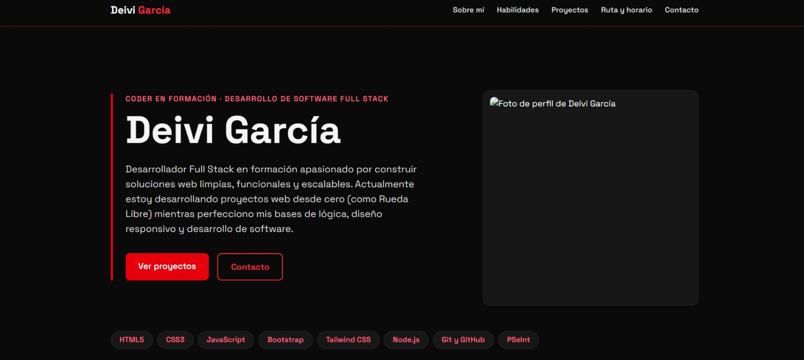

# Deivi García · Portafolio web

Portafolio personal de Deivi García, Coder en Riwi en Medellín, en formación de Desarrollo de Software Full Stack. Es un sitio de una sola página, responsive, construido con HTML5 semántico y Tailwind CSS v4.

| | |
|---|---|
| Sitio publicado | https://deivilegend.github.io/portafolio-deivi/ |
| Repositorio | https://github.com/Deivilegend/portafolio-deivi |
| Autor | https://github.com/Deivilegend |



## Qué contiene la página

| Sección | Qué muestra | Cómo está armada |
|---|---|---|
| Portada (`#inicio`) | Nombre, rol, resumen, dos botones y 8 etiquetas de tecnologías | Dos bloques asimétricos, con borde izquierdo rojo (`border-l-4`) |
| Sobre mí (`#sobre-mi`) | "Construir, iterar y escalar": saludo, su camino, su meta y datos rápidos | Bento grid de tarjetas de distinto tamaño |
| Habilidades (`#habilidades`) | Tecnologías agrupadas en 4 tarjetas | Tarjetas con borde superior rojo (`border-t-2`) |
| Proyectos (`#proyectos`) | Rueda Libre, Portafolio Personal y Proyecto de Lógica y Algoritmos | Tarjetas de alto contraste con imagen y enlace al repositorio |
| Ruta y horario (`#ruta`) | Evolución SENA → Riwi → Desarrollo Full Stack → Arquitecto de Software, y horario de lunes a viernes | Línea de tiempo vertical (`border-l-2`) y tabla con scroll horizontal en pantallas estrechas |
| Contacto (`#contacto`) | Formulario (nombre, correo, mensaje) y contacto directo | Formulario con campos subrayados y bloque lateral |

## Diseño

Estilo editorial y tecnológico, en negro y rojo.

| Uso | Clases de Tailwind |
|---|---|
| Fondo de la página | `bg-neutral-950` |
| Tarjetas y bordes | `bg-neutral-900`, `border-neutral-800` |
| Acento principal | `red-600` y `red-500` |
| Detalles sutiles | `rose-400` |
| Texto | `neutral-100` en títulos y `neutral-300` en párrafos |
| Botones principales | `bg-red-600 hover:bg-red-700 text-white` |
| Líneas del header y del footer | `border-red-900` |

Tipografía: Space Grotesk (pesos 400, 600 y 700) cargada desde Google Fonts y declarada en `@theme` como `--font-display`.

## Responsive, paso a paso

El diseño parte del móvil y agrega prefijos para pantallas mayores.

| Punto de quiebre | Qué cambia |
|---|---|
| Móvil (sin prefijo) | Todo en una columna; el menú se acomoda con `flex-wrap` |
| `sm:` (640 px) | Header en fila, habilidades en 2 columnas, Nombre y Correo lado a lado, footer en fila y títulos más grandes |
| `md:` (768 px) | Sobre mí en 2 columnas y proyectos en 2 columnas |
| `lg:` (1024 px) | Portada en grilla de 12 columnas (7 + 5) con la foto desplazada; Sobre mí en 3 columnas con "Datos rápidos" en alto; habilidades en 4 columnas; proyectos en 3; ruta en 2 columnas (línea de tiempo y horario); contacto en 5 columnas (formulario 3 y contacto directo 2) |

## Cómo se usa Tailwind

- Tailwind CSS v4 mediante Play CDN: `https://cdn.jsdelivr.net/npm/@tailwindcss/browser@4`.
- El único CSS propio es el bloque `@theme` de la tipografía. No hay archivos `.css` ni atributos `style`.
- Todo el diseño está hecho con clases utilitarias: grid, flex, espaciado, color, bordes y sombras.
- Estados interactivos con `hover:` y `focus:`, incluido un anillo de foco visible en enlaces, botones y campos.

## Accesibilidad

- `lang="es"`, un solo `h1` y jerarquía de títulos `h1` > `h2` > `h3` sin saltos.
- Cada sección se relaciona con su título mediante `aria-labelledby`.
- Cada campo del formulario tiene su `<label for="...">`, con `required`, `minlength` y `autocomplete`.
- Todas las imágenes tienen texto alternativo.
- La tabla de horario usa `caption` y `scope` en sus encabezados.
- Los adornos de la línea de tiempo están ocultos para lectores de pantalla con `aria-hidden`.
- Los enlaces que abren en otra pestaña usan `rel="noopener noreferrer"`.

## Proyectos enlazados

| Proyecto | Tecnologías | Repositorio |
|---|---|---|
| Rueda Libre | HTML5, CSS3, Bootstrap | https://github.com/Deivilegend/rueda-libre |
| Portafolio Personal | HTML5, Tailwind CSS | https://github.com/Deivilegend/portafolio-deivi |
| Proyecto de Lógica y Algoritmos | PSeInt, JavaScript | https://github.com/Deivilegend/Algoritmia |

## Estructura del repositorio

```
portafolio-deivi/
├── index.html
├── README.md
└── img/
    ├── perfil-deivi.jpeg
    ├── rueda-lbre.jpeg
    ├── portafolio.jpeg
    └── algoritmia.jpeg
```

## Cómo verlo en local

Abrir `index.html` en el navegador, o con Live Server desde VS Code. Necesita conexión a internet para cargar Tailwind y la fuente.

## Límites conocidos

- Play CDN genera los estilos en el navegador. Tailwind lo recomienda para desarrollo, no para producción. Se eligió por ser la forma más directa de usar Tailwind sin proceso de compilación; en un proyecto en producción se compilaría con Tailwind CLI.
- El formulario de contacto es de maquetación: valida los campos con HTML5, pero todavía no envía mensajes.

## Autor

Deivi García · Coder en Riwi · Medellín · https://github.com/Deivilegend